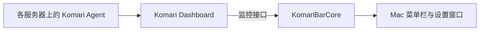

# 首版设计

KomariBar 是独立的原生 Mac 菜单栏客户端。服务器侧继续使用 Komari Dashboard 和 Agent，客户端通过官方监控接口读取状态与历史数据。

## 模块分工

- `KomariBarCore`：接口请求、响应转换和流量口径计算。接入模块统一输出服务器信息、快照与历史点，界面不直接解析接口响应。
- `KomariBar`：SwiftUI 菜单栏弹窗、服务器切换、设置、刷新与示例模式；非敏感偏好使用 UserDefaults，认证凭据使用 macOS 钥匙串。
- Komari Dashboard／Agent：持续采集和保存服务器指标。Mac 客户端退出不影响服务器侧采集。

首版面向一个面板中的多台服务器。后续如增加多个面板，服务器标识需要与面板身份组合，避免不同面板中的同名或同 UUID 节点相互覆盖。

## 流量数据

网络速度与累计字节数是不同的数据。客户端使用 Agent 上报的累计上传与下载量计算用量，不将降采样后的速度曲线积分成账期用量。

Agent 是否按月重置不能仅从节点的套餐购买周期推断。首版要求用户在每台服务器的流量设置中确认 Agent 的月重置配置，并填写同样的重置日与时区；未经确认时显示累计流量，不把它称作本月用量。

账期计算对齐 Komari Agent 1.5.11 的行为：在 Agent 所用时区的当天零点重置；某月没有指定日期时，顺延至次月 1 日。例如配置每月 31 日时，二月对应的边界是三月 1 日，而不是二月最后一天。

计量方式支持上传、下载、双向之和、双向取较大值。取较大值时使用整个周期上传总数与下载总数的较大者。流量额度与剩余额度属于估算，不能替代服务商后台计量。

## 接口与验证范围

当前以 Komari Dashboard 1.6.1 的官方接口和样本为适配基准。Core 测试覆盖请求与响应处理、错误、流量口径、账期边界。源码构建、示例模式和样本测试不能替代真实 Komari 实例的端到端验证；接入实际部署后仍需核对版本、认证、历史数据和 Agent 的流量重置配置。

Komari 普通 API Key 具有管理员权限。客户端只调用监控接口，这不会改变令牌在服务端的权限。公开面板可不填写 API Key；私有面板按部署要求提供凭据。不要使用 Agent 上报 Token 代替管理员 API Key。

原生应用的 ATS 配置允许用户填写公开 HTTP 面板。认证另设限制：携带 API Key 的连接必须使用 HTTPS，只有回环地址允许 HTTP 认证以支持本机 SSH 隧道。HTTPS 请求继续使用系统信任校验，不接受无效证书。

## 后续方向

- 真实 Komari 实例的兼容性验证与更清晰的接入诊断。
- 多面板接入、菜单栏指标偏好与登录时启动。
- 适合发布的 Developer ID 签名、公证和版本更新流程。

参考：[Komari 接口文档](https://www.komari.wiki/dev/api)、[月流量设置](https://www.komari.wiki/faq/faq)、[Komari Agent 日期实现](https://github.com/komari-monitor/komari-agent/blob/1.5.11/utils/utils.go)。
