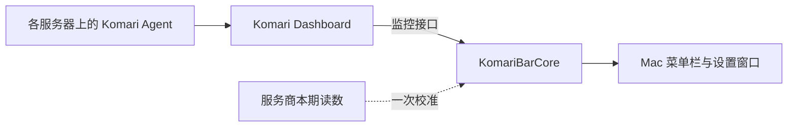

# 首版设计

KomariBar 是独立的原生 Mac 菜单栏客户端。服务器侧继续使用 Komari Dashboard 和 Agent，客户端通过官方监控接口读取状态与历史数据。

## 模块分工

- `KomariBarCore`：接口请求、响应转换、流量口径和校准计算。接入模块统一输出服务器信息、快照与历史点，界面不直接解析接口响应；`TrafficCalibration.create` 负责验证并建立服务商读数与 Agent 计数的对应关系。
- `KomariBar`：SwiftUI 菜单栏弹窗、服务器切换、设置、刷新与示例模式。面板地址、刷新偏好、流量设置与校准记录保存在本机 UserDefaults，认证凭据使用 macOS 钥匙串。
- Komari Dashboard／Agent：持续采集和保存服务器指标。Mac 客户端退出不影响服务器侧采集。

首版面向一个面板中的多台服务器。后续如增加多个面板，服务器标识需要与面板身份组合，避免不同面板中的同名或同 UUID 节点相互覆盖。

## 流量数据

网络速度与累计字节数是不同的数据。客户端使用 Agent 上报的累计上传与下载量计算用量，不将降采样后的速度曲线积分成账期用量。

Agent 是否按月重置不能仅从节点的套餐购买周期推断。首版要求用户在每台服务器的流量设置中确认 Agent 的月重置配置，并填写同样的重置日与时区；未经确认时显示累计流量，不把它称作本月用量。

账期计算对齐 Komari Agent 1.5.11 的行为：在 Agent 所用时区的当天零点重置；某月没有指定日期时，顺延至次月 1 日。例如配置每月 31 日时，二月对应的边界是三月 1 日，而不是二月最后一天。

计量方式支持上传、下载、双向之和、双向取较大值或较小值。取较大值时使用整个周期上传总数与下载总数的较大者。流量额度与剩余额度属于估算，不能替代服务商后台计量。

统计开始时间未知或位于当前账期中途时，默认仅显示已记录用量，不显示完整预算。可用服务商的本期合计和上传下载读数创建一次校准；此后按对应 Agent 计数的增量计算“本期估算”，并显示基准、来源和时间，不补造历史曲线，也不声称已接入服务商实时账单接口。

校准绑定面板下的节点、账期、计量方式和统计开始时间。额度改变可继续使用校准；下一账期自动忽略旧校准。AppState 在替换快照前调用核心模块检查计数回退，并持久化失效标记，避免计数回涨后错误恢复估算。

## 接口与验证范围

当前以 Komari Dashboard 1.6.1 的官方接口和样本为适配基准，已通过 SSH 隧道验证 Dashboard 1.6.1／Agent 1.5.11 的真实节点、认证、历史曲线及流量采集。Core 测试覆盖接口处理、认证重定向、账期边界、首期覆盖、刷新设置、校准增量和失效条件；其他版本仍需进行兼容性验证。

Komari 普通 API Key 具有管理员权限。客户端只调用监控接口，这不会改变令牌在服务端的权限。公开面板可不填写 API Key；私有面板按部署要求提供凭据。不要使用 Agent 上报 Token 代替管理员 API Key。

原生应用的 ATS 配置允许用户填写公开 HTTP 面板。认证另设限制：携带 API Key 的连接必须使用 HTTPS，只有回环地址允许 HTTP 认证以支持本机 SSH 隧道。HTTPS 请求继续使用系统信任校验，不接受无效证书。

## 后续方向

- 更多 Komari 版本的兼容性验证与更清晰的接入诊断。
- 多面板接入、菜单栏指标偏好与登录时启动。
- 适合发布的 Developer ID 签名、公证和版本更新流程。

参考：[Komari 接口文档](https://www.komari.wiki/dev/api)、[月流量设置](https://www.komari.wiki/faq/faq)、[Komari Agent 日期实现](https://github.com/komari-monitor/komari-agent/blob/1.5.11/utils/utils.go)。
